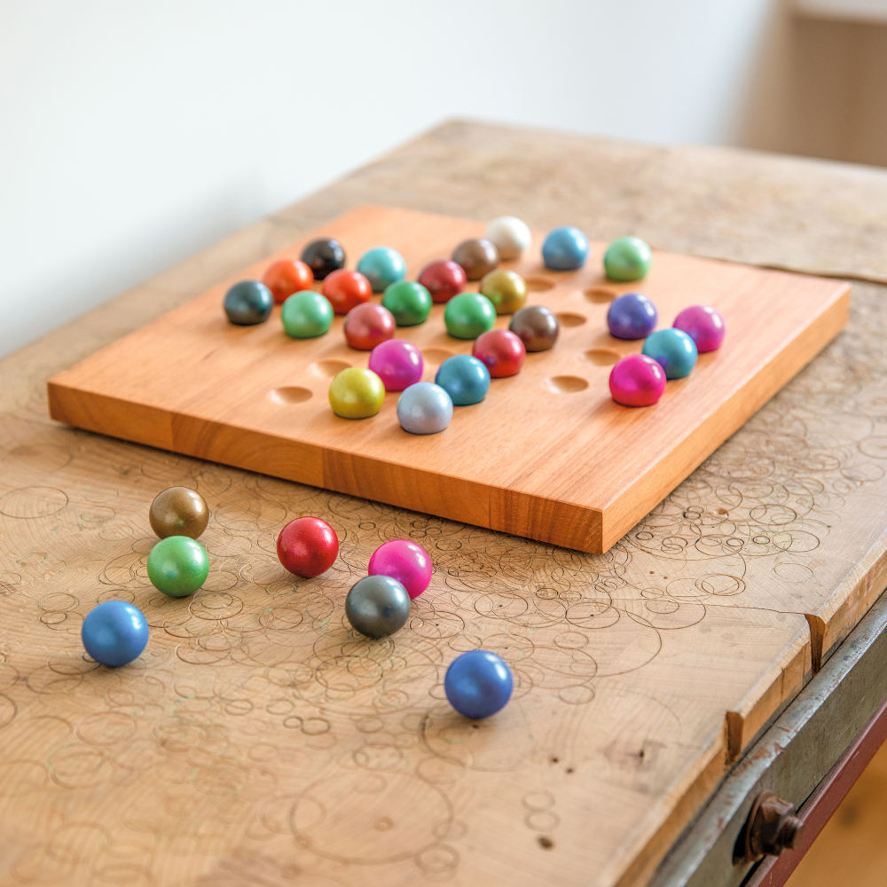
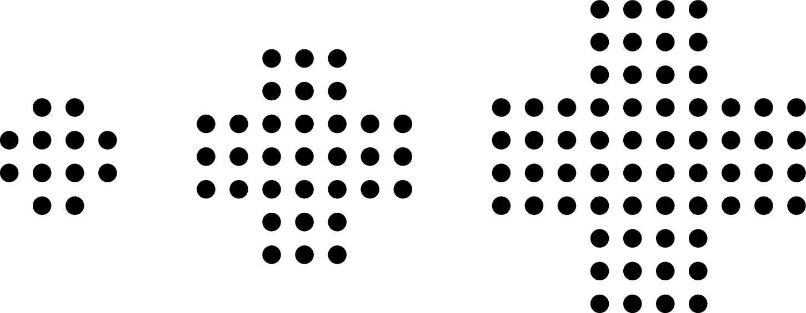

Solitaire is een bordspel dat door één persoon wordt gespeeld en waarbij het de bedoeling is volgens bepaalde regels een probleem op te lossen. Het klassieke solitairespel wordt gedetailleerd beschreven door Ovidius. Het spel is echter waarschijnlijk vaker ontdekt.

{:data-caption="Het solitaire bordspel." width="40%"}

In de Engelse stijl van het spel passen er drie knikkers in één zijde van de kruisvorm op het bord. In deze opgave zijn we echter geïntereseerd in een versie met meer (of minder) knikkers.

Hieronder vind je voorbeelden van zo'n borden met 2, 3 en 4 knikkers in één zijde.

{:data-caption="Aangepaste borden." .light-only width="40%"}

{:data-caption="Aangepaste borden." .dark-only width="40%"}

## Opgave

Schrijf een programma dat aan de gebruiker het **aantal knikkers** in één zijde vraagt en daarna het totale aantal knikkers op het bord uitrekent. Je mag ervan uit gaan dat het aantal knikkers in één zijde steeds meer dan 1 is.

#### Voorbeelden

Bij invoer `3` verschijnt er:

```
Er zijn op dit bord 33 knikkers aanwezig.
```

Bij invoer `4` verschijnt er:

```
Er zijn op dit bord 64 knikkers aanwezig.
```