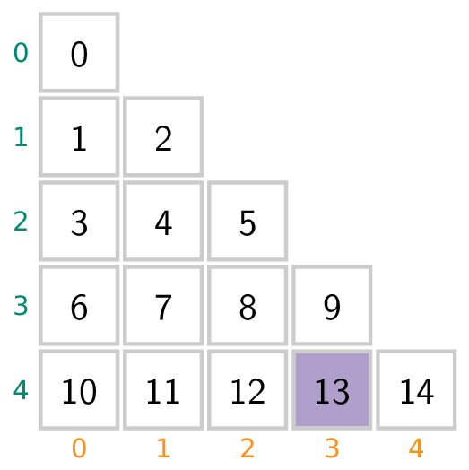
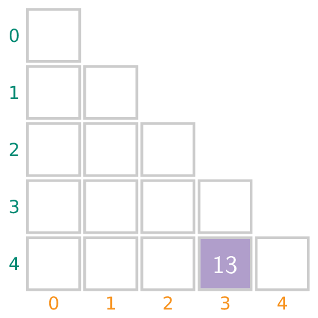

Stel dat men de natuurlijke getallen naast en onder elkaar noteert in een driehoekig schema als volgt:

{:data-caption="Een schema met de natuurlijke getallen." .light-only height="200px"}

{:data-caption="Een schema met de natuurlijke getallen." .dark-only height="200px"}

Dan stellen we vast dat **13** op de vierde regel voorkomt en dit op de derde plaats.

## Opgave
Schrijf een programma dat aan de gebruiker een natuurlijk getal vraagt en vervolgens bepaal je op welke regel en welke plaats dit getal in het schema staat.

#### Voorbeelden

Voor invoer `13` verschijnt er:
```
13 staat op regel 4 en kolom 3
```

Bij invoer `64` verschijnt er:
```
64 staat op regel 10 en kolom 9
```