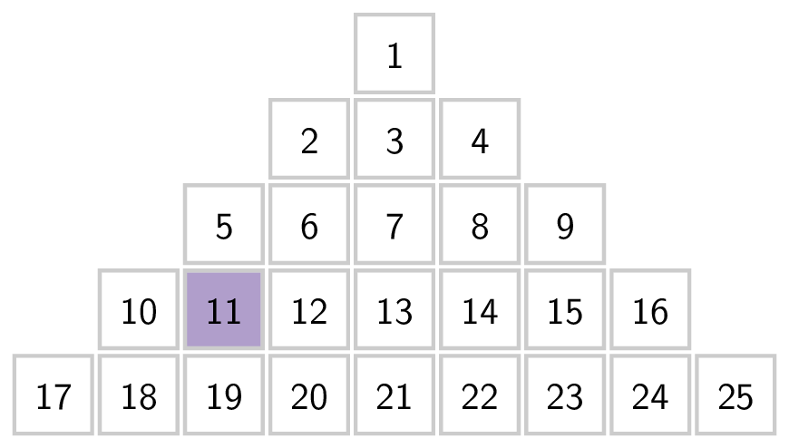
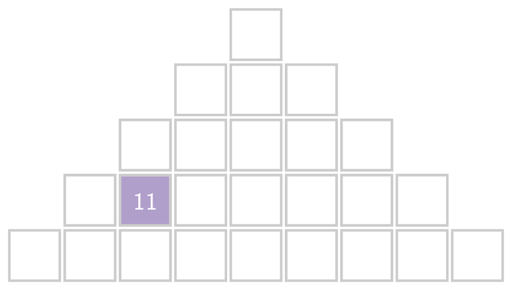

Men schrijft de getallen 1, 2, 3, ... naast en onder elkaar in een piramidevorm als volgt:

{:data-caption="Een schema met de natuurlijke getallen." .light-only height="240px"}

{:data-caption="Een schema met de natuurlijke getallen." .dark-only height="240px"}

Dan stellen we vast dat het getal **11** op de vierde regel voorkomt en dit op de tweede plaats.

## Opgave
Schrijf een programma dat aan de gebruiker een natuurlijk getal (> 0) vraagt en vervolgens bepaal je op welke regel en welke plaats dit getal in het schema staat.

#### Voorbeelden

Voor invoer `11` verschijnt er:
```
11 staat in regel 4 op plaats 2
```

Bij invoer `62` verschijnt er:
```
62 staat in regel 8 op plaats 13
```

Bij invoer `122` verschijnt er:
```
122 staat in regel 12 op plaats 1
```