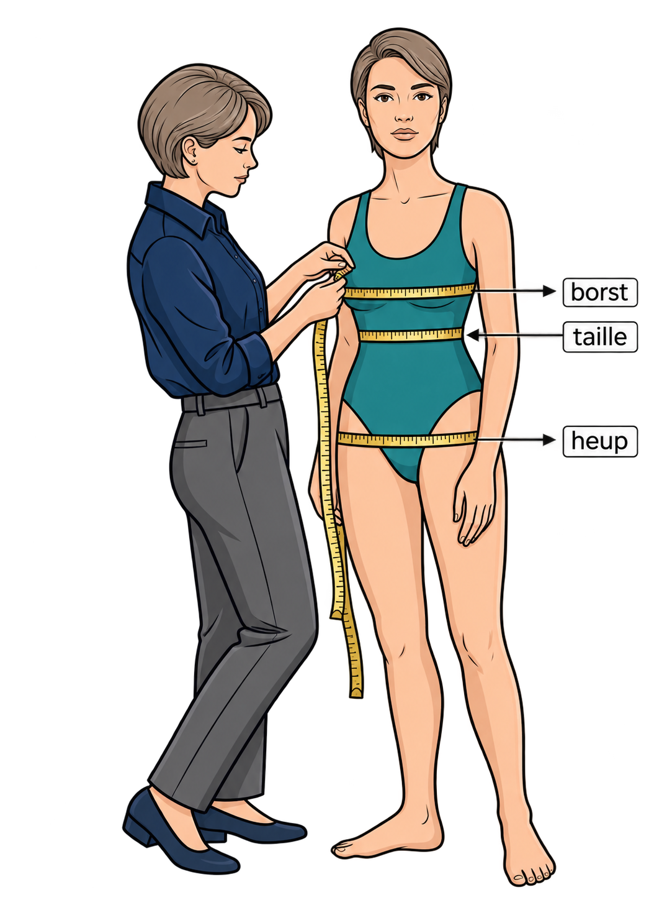
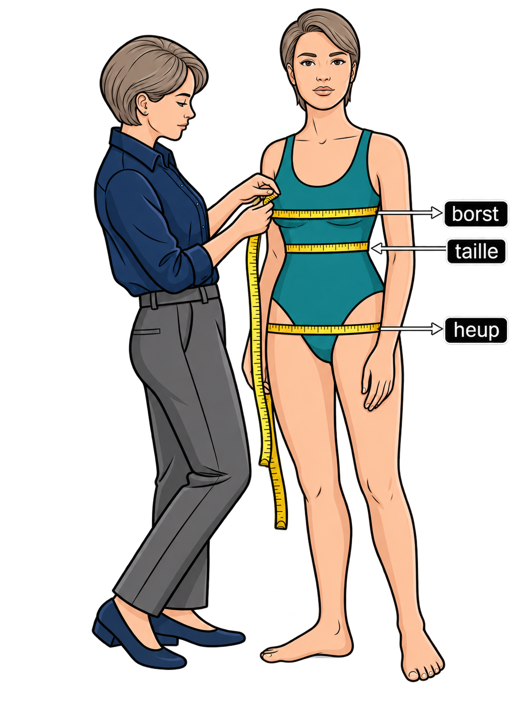

Van veel mensen zoals fotomodellen, kledingmodellen, acteurs, actrices en atleten wordt beweerd dat ze een *goed figuur* hebben. Maar wanneer kun je spreken van een *goed figuur*? Om een *goed figuur* van mannen en vrouwen in een getal uit te kunnen drukken, hanteert men de zogenoemde androgynie-index. De androgynie-index wordt als volgt berekend:

$$
\mathsf{\dfrac{t}{\sqrt{h \cdot b}}}
$$

Hierin is b de borstmaat in cm, t de taillemaat in cm en h de heupmaat in cm. Deze maten worden gemeten door een meetlint rond het lichaam te passen op de hoogte van de borst, taille respectievelijk heup. 

{:data-caption="Afbeelding gegeneerd door ChatGPT 8-11-2026." width="30%" .light-only}

{:data-caption="Afbeelding gegeneerd door ChatGPT 8-11-2026." width="30%" .dark-only}

Zo heeft Arnold Schwarzenegger heeft een androgynie-index van 0,83. De borst-, taille- en heupmaat van de gespierde Schwarzenegger zijn respectievelijk 111 cm, 91 cm en 108 cm.

Een modellenbureau schrijft modellen alleen in als de androgynie-index voor vrouwen tussen de waarden 0,67 en 0,70 en voor mannen tussen 0,80 en 0,84 ligt.

## Opgave
Schrijf een programma dat in volgorde vraagt naar het biologische geslacht van een persoon `man` of `vrouw`. Vraag nadien (in volgorde) naar de borst-, taille- en heupmaten (in cm).

Bereken de androgynie index (op twee decimalen) en geef aan of deze persoon in aanmerking komt voor een opdracht bij het modellenbureau.

#### Voorbeelden

Voor Arnold Schwarzenegger van het biologische geslacht `"man"` en met de maten `111`, `91` en `108` verschijnt er:
```
Androgynie-index: 0.83
Je komt in aanmerking als model.
```

Voor Marilyn Monroe van het biologische geslacht `"vrouw"` en met de maten `91`, `61` en `89` verschijnt er:
```
Androgynie-index: 0.68
Je komt niet in aanmerking als model.
```
