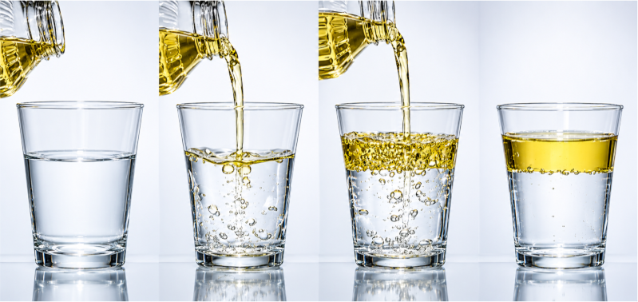
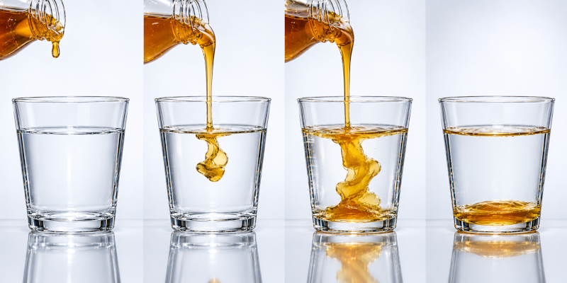

Je hebt zeker al gemerkt hoe olie blijft drijven op water. Aanvankelijk zal dit water er wat troebel uitzien, vol met kleine bellen olie, maar na een eindje merk je een duidelijke schifing. Olie komt steeds boven drijven.

{:data-caption="Olie drijft op water" width="50%"}

Bij honing is het verhaal echter anders, daar zal de zwaardere vloeistof eerder zinken. Na een eindje zal deze vloeistof zelfs oplossen in water.

{:data-caption="Honing zinkt in water" width="50%"}

## Opgave

Vraag aan de gebruiker het volume (in cℓ) van de vloeistof en de massa (in g) en bereken vervolgens of dit zal drijven of zinken in water.

#### Voorbeelden

Als de gebruiker `10` cℓ olie met een massa van `91.6` g in het water giet, dan verschijnt er:

```
Deze vloeistof drijft in water.
```

Als de gebruiker `20` cℓ honing met een massa van `272.0` g in het water giet, dan verschijnt er:

```
Deze vloeistof zinkt in water.
```

{: .callout.callout-info}
> #### Tip
> De massadichtheid van zuiver water is 1 kg/ℓ.