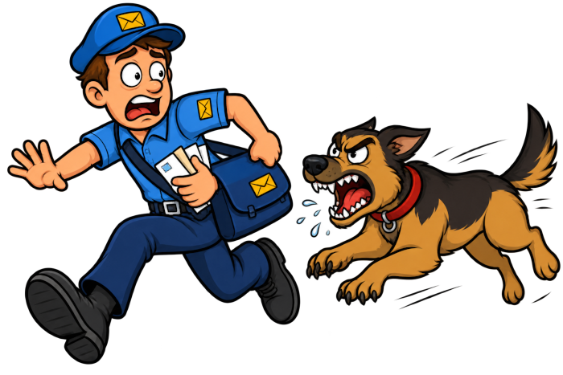

De lokale postbode heeft een probleem. Bij het leveren van de krant bij de woning kan de hond agressief zijn. Hij weet echter niet dat het gedrag van de hond voorspelbaar is.

Bij het starten van de dag is de hond gedurende a minuten agressief en daarna r minuten rustig. En hetzelfde patroon herhaalt zicht tot het einde van de dag, een agressieve periode, telkens afgewisseld met een rustige periode.

{:data-caption="Tekening gemaakt met ChatGPT op 8 november 2026." width="100%"}

## Opgave
Schrijf een programma dat eerst vraagt naar a, het aantal minuten dat de hond agressief is en erna naar r, het aantal minuten dat de hond rustig is.

Vraag vervolgens op welke minuut van de dag de postbode langskomt. Geef vervolgens weer of de hond al dan niet agressief zal zijn.

#### Voorbeelden

Indien de hond `2` minuten agressief is en `3` minuten rustig, en de postbode komt langs op minuut `9`, dan verschijnt er:
```
De hond is rustig.
```

Indien de hond `2` minuten agressief is en `3` minuten rustig, en de postbode komt langs op minuut `4`, dan verschijnt er:
```
De hond is agressief.
```