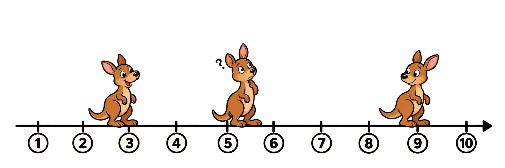
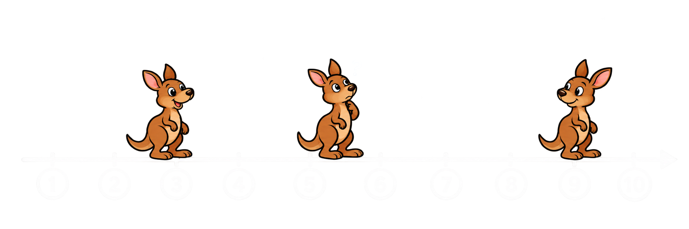

Drie kangoeroes spelen in de savanne. Ze spelen op een getallenas en elke kangoeroe staat op één specifiek geheel getal. In een beurt mag één van de kangoeroes aan de buitenrand springen naar een positie tussen de andere twee. Op geen enkel moment mogen kangoeroes een plek delen.

Help de kangoeroes zo lang mogelijk te spelen.

{:data-caption="Afbeelding gegeneerd door ChatGPT 8-11-2026." width="30%" .light-only}

{:data-caption="Afbeelding gegeneerd door ChatGPT 8-11-2026." width="30%" .dark-only}

In het bovenstaande geval kunnen ze maximaal drie sprongen uitvoeren. Bijvoorbeeld: kangoeroe 3 springt naar positie 8, kangoeroe 9 naar positie 6 en kangoeroe 5 naar positie 7.

## Opgave
Schrijf een programma dat de posities van de drie kangoeroes vraagt en daarna het maximale aantal sprongen afdrukt.

Je mag ervan uit gaan dat de posities in stijgende volgorde worden ingevoerd. Er is steeds minstens één sprong mogelijk.

#### Voorbeelden

Bij invoer `3`, `5`, `9` verschijnt:
```
Er zijn 3 sprongen mogelijk.
```

Bij invoer `2`, `3`, `5` verschijnt:
```
Er is één sprong mogelijk.
```

{: .callout.callout-info}
> #### Bron
> Croatian Open Competition in Informatics 2008/2009