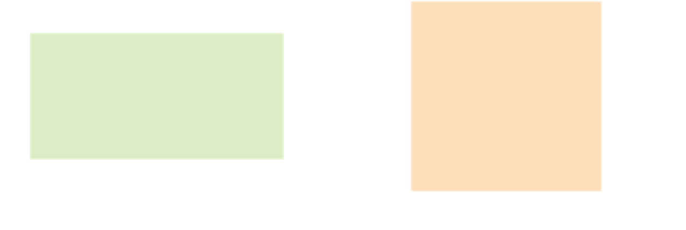

Beschouw onderstaande rechthoek met afmetingen x en 2x en het vierkant met als zijde x + 1.

{:data-caption="Rechthoek en vierkant." height="100px" .light-only}

{:data-caption="Rechthoek en vierkant." height="100px" .dark-only}

## Opgave
Vraag aan de gebruiker de lengte van de onbekende x en bereken vervolgens welke oppervlakte het grootst is. Toon deze oppervlakte ook op het scherm. Indien de oppervlakte even groot is, kies dan voor het vierkant.

Rond de oppervlakte af op twee decimalen.

#### Voorbeelden

Bij de invoer x = `5.4` verschijnt er:

```
De rechthoek heeft de grootste oppervlakte.
Deze oppervlakte bedraagt: 58.32
```

Bij de invoer x = `2.3` verschijnt er:

```
Het vierkant heeft de grootste oppervlakte.
Deze oppervlakte bedraagt: 10.89
```