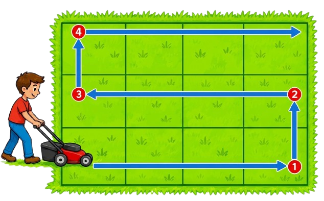

Mirko is op zoek naar een huis met een rechthoekige tuin, bestaande uit een rooster van `n` rijen en `m` kolommen. Om het volledige grasveld te maaien, moet hij met zijn grasmaaier minstens één keer over elk vakje rijden, zonder de tuin te verlaten.

Hij mag starten op een willekeurig vakje aan de rand van de tuin, gericht naar het noorden, oosten, zuiden of westen. Tijdens het maaien kan hij enkel rechtdoor rijden of een bocht van 90° maken. Omdat draaien lastig is, wil hij zo **weinig mogelijk bochten** nemen.

Als je de afmetingen van de tuin kent, hoeveel keer moet Mirko dan draaien? Bij een tuin van `3` rijen en `4` kolommen is een optimale maairoute bijvoorbeeld de volgende:

{:data-caption="Afbeelding gegenereerd door Gemini 24-11-2026." height="200px"}

Hierbij draait Mirko zijn grasmaaier **vier keer**.

## Opgave
Schrijf een programma dat vraagt naar het aantal rijen en het aantal kolommen en vervolgens het minimale aantal keer dat Mirko moet draaien op het scherm weergeeft.

#### Voorbeelden

Bij een tuin van `3` rijen en `4` kolommen verschijnt:
```
Mikro moet zijn grasmaaier 4 keer draaien.
```

Bij een tuin van `4` rijen en `3` kolommen verschijnt:
```
Mikro moet zijn grasmaaier 4 keer draaien.
```

Bij een tuin van `5` rijen en `8` kolommen verschijnt:
```
Mikro moet zijn grasmaaier 8 keer draaien.
```

{: .callout.callout-info}
> #### Bron
> Croatian Open Competition in Informatics 2017/2018