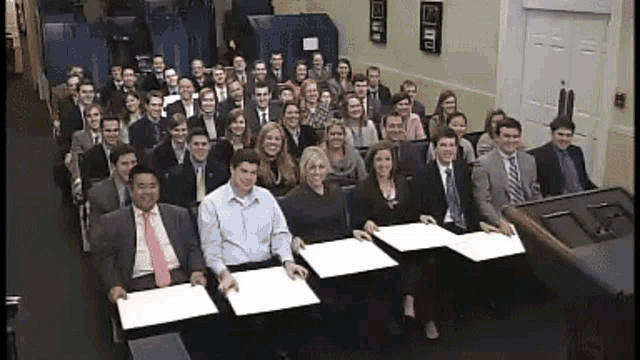

In een populaire kookwedstrijd krijgen vijf deelnemers van vier juryleden een score van 1 tot en met 10. Elke deelnemer krijgt vervolgens de som van die vier aparte scores.

{:data-caption="Een puntverdeling." width="300px"}

## Opgave

Schrijf een programma dat **per deelnemer** naar de **vier scores** van de juryleden vragen.

Vervolgens geef je de hoogste score weer. Je mag ervan uitgaan dat er telkens één hoogste resultaat is.

#### Voorbeeld

Als de eerste deelnemer de scores `8`, `6`, `7`, `9`, de tweede deelnemer `10`, `10`, `5`, `8`, de derde deelnemer `9`, `5`, `6`, `7`, de vierde deelnemer `7`, `5`, `4`, `5` en de laatste deelnemer de scores `3`, `6`, `5` en `3` krijgt, dan verschijnt er:

```
Deelnemer 2 behaalde de hoogste score, namelijk: 33 punten.
```

{: .callout.callout-info}
> #### Bron
> Croatian Open Competition in Informatics 2008/2009